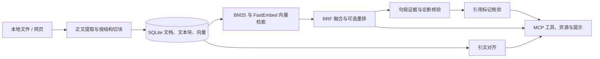

# DocCite

DocCite 是一个本地文档检索与引用核验 MCP 服务。客户端可以先检索证据并生成带引用的回答，再定位引文、核对数字和检查引用的文档或页码。默认检索和核验在本机运行，首次使用向量检索或重排会下载对应的 ONNX 模型。

## 快速开始

在项目根目录运行以下命令。项目使用 Python 3.13 和 uv。

```powershell
uv sync --locked
uv run doccite ingest examples/corpus
uv run doccite search "青岚试点的单位产水能耗降低多少"
uv run doccite search "Harbor Ferry operating costs" --mode bm25
```

支持 UTF-8 Markdown/TXT、含文本层的 PDF、DOCX、HTML 和 HTTP(S) 网页。目录入库默认递归。索引和模型缓存默认位于项目下的 `.doccite/`。重新入库时按内容哈希跳过未变文件，内容变更时更新相应文档的文本、块和向量缓存。

## 设计



检索结果包含标题、PDF 原始页码、标题层级和块 ID。`start` 与 `end` 是提取后全文中的 Python 字符索引，左闭右开。可通过 `doccite://documents/{doc_id}` 按偏移复核文本，通过 `doccite://chunks/{chunk_id}` 读取单块，或通过 `doccite://stats` 查看索引统计。

| 工具 | 行为 |
| --- | --- |
| `ingest_documents`、`ingest_url` | 导入文件、目录或网页，返回每个来源的入库状态 |
| `list_documents`、`remove_document` | 查看文档 ID、管理索引条目 |
| `search`、`read_chunk` | 检索证据，读取同文档的相邻块 |
| `verify_quote` | 返回逐字匹配、排版归一化匹配、近似匹配或未找到，并提供可用的原文位置和差异 |
| `verify_claim` | 返回证据句、裁决及数字、限定条件和关键词差异 |
| `verify_citations` | 检查 `[1]`、`[^1]`、`[doc_id:p12]`，为无引用论断提供候选证据 |

本地论断核验采用保守的句级规则。语义相似度用于给候选证据排序，完整支持还要求论断与证据句措辞一致，或是证据句中按词对齐的一段摘录，并且论断中的每个数字都能在证据中找到（证据可以多出日期等数字，`12 percent`、`百分之 12` 与 `12%` 视为相同）。否定按整词判断，“不同”“未来”“无人机”不算否定。改写过的论断通常只得到部分支持。

`verify_claim` 的 `judge` 参数选择裁决方式，默认取 `DOCCITE_CLAIM_JUDGE`：

- `rules`：上述本地规则。
- `nli`：在本机用 ONNX 运行多语言 NLI 模型（mDeBERTa-v3-base-xnli，量化版约 340 MB，首次使用时下载）。模型对规则排名前 8 的证据句及其与相邻句拼成的两句窗口判断蕴含或矛盾，可以给出 `CONTRADICTED`，也能认可改写。模型判为蕴含时，如果该证据句缺少论断中的数字、限定条件不一致，或缺少论断中的专有名词（文档标题中有的除外），也只给部分支持。模型不可用时退回规则结果，并在 `issues` 中注明。
- `llm`：在客户端支持 MCP sampling 时，把论断和证据句交给客户端模型判断。客户端不支持 sampling 或请求失败时，返回本地核验结果。

`verify_citations` 使用 `DOCCITE_CLAIM_JUDGE` 指定的本地裁决方式。

| 环境变量 | 默认值 |
| --- | --- |
| `DOCCITE_DATA_DIR` | `.doccite` |
| `DOCCITE_CHUNK_SIZE` / `DOCCITE_CHUNK_OVERLAP` | 600 / 100 个字符 |
| `DOCCITE_ENABLE_DENSE` | `true`，设为 `false` 可直接使用 BM25 |
| `DOCCITE_EMBEDDING_MODEL` | `BAAI/bge-small-zh-v1.5` |
| `DOCCITE_RERANKER_MODEL` | `BAAI/bge-reranker-base` |
| `DOCCITE_CLAIM_RERANK` | `false`，设为 `true` 对候选证据句运行重排 |
| `DOCCITE_QUOTE_THRESHOLD` | 0.80 |
| `DOCCITE_CLAIM_PARTIAL_THRESHOLD` / `DOCCITE_CLAIM_SUPPORTED_THRESHOLD` | 0.50 / 0.90 |
| `DOCCITE_CLAIM_JUDGE` | `rules`，设为 `nli` 使用本地 NLI 模型 |
| `DOCCITE_NLI_MODEL` / `DOCCITE_NLI_ONNX_FILE` | `MoritzLaurer/mDeBERTa-v3-base-xnli-multilingual-nli-2mil7` / `onnx/model_quantized.onnx` |
| `DOCCITE_NLI_CANDIDATES` | 8，交给 NLI 的证据句数 |
| `DOCCITE_NLI_ENTAIL_THRESHOLD` / `DOCCITE_NLI_CONTRADICT_THRESHOLD` | 0.50 / 0.50 |

## 接入 MCP 客户端

### Claude Code

在项目目录运行以下命令。按实际检出路径调整 `--directory`。[Claude Code MCP 配置文档](https://code.claude.com/docs/en/mcp#option-3-add-a-local-stdio-server)

```powershell
claude mcp add --transport stdio doccite -- uv --directory 'D:\code\projects\MCP-demo' run --locked doccite serve
claude mcp get doccite
```

### Claude Desktop

在 Claude Desktop 的开发者设置中打开 `claude_desktop_config.json`，将下例中的 `doccite` 条目加入 `mcpServers`，重启客户端。Windows 下可用 `(Get-Command uv).Source` 确定 `uv.exe` 路径。[本地 MCP 服务配置文档](https://modelcontextprotocol.io/docs/develop/connect-local-servers)

```json
{
  "mcpServers": {
    "doccite": {
      "command": "E:\\Develop\\Python\\Scripts\\uv.exe",
      "args": [
        "--directory", "D:\\code\\projects\\MCP-demo",
        "run", "--locked", "doccite", "serve"
      ]
    }
  }
}
```

### MCP Inspector 与本地 HTTP

用 Inspector 查看工具、资源和提示，或用 Streamable HTTP 连接本机服务。[MCP Inspector 文档](https://modelcontextprotocol.io/docs/tools/inspector)

```powershell
npx @modelcontextprotocol/inspector uv run --locked doccite serve
uv run --locked doccite serve --transport streamable-http --host 127.0.0.1 --port 8000
```

HTTP MCP 地址是 `http://127.0.0.1:8000/mcp`。服务默认监听回环地址，同机客户端可通过工具读取本地文件和抓取网页。

## 演示

> 导入 `examples/corpus`。使用 `answer_with_citations` 查找 Harbor Ferry 试点的运营成本变化，再用 `fact_check` 核验下面这句话。把 `[1]` 映射到入库返回的 ferry 文档 ID。
>
> The pilot reduced operating costs by 21% [1]. Another report confirmed the result [fabricated:p1].

原文的运营成本降幅为 12%。`verify_quote` 将改过数字的引文标为 `modified`，`verify_claim` 返回 `PARTIALLY_SUPPORTED` 并列出数字差异，`verify_citations` 将第二条来源标为 `missing_document`。编号引用通过 `sources` 参数指定，例如 `{"1": "<doc_id>"}` 或 `{"1": "<doc_id>:p3"}`。`[^1]` 与 `[1]` 共用编号映射。

## 评测与测试

```powershell
uv run --locked doccite eval
uv run --locked doccite eval-public
uv run --locked ruff check .
uv run --locked pytest
```

两个命令的索引都与日常使用的索引分开保存。`--judge rules` 或 `--judge nli` 只评测一种裁决方式，默认两种都评。

### 自编评测集

`doccite eval` 使用 8 份自编中英文文档、24 个文本块、12 条检索查询和 34 条按类别标注的论断。默认模型的本机实测结果如下。

| 检索方式 | Recall@5 | MRR@5 |
| --- | ---: | ---: |
| BM25 | 0.833 | 0.736 |
| 向量 | 1.000 | 0.854 |
| 混合 | 1.000 | 0.917 |
| 混合 + 重排 | 1.000 | 0.958 |

论断标签的含义：`SUPPORTED` 为原文确实支持；`PARTIALLY_SUPPORTED` 为找到相关原文，但数字、否定、主体或限定条件与原文不一致；`NOT_FOUND` 为语料中没有相关证据。对 `PARTIALLY_SUPPORTED` 标签，预测为 `CONTRADICTED` 也算命中。分类结果如下。

| 类别 | 说明 | rules | nli |
| --- | --- | ---: | ---: |
| 原句 | 与原文句子一致 | 6/6 | 6/6 |
| 摘录 | 原句的一段，或 `12 percent`、`百分之 8.5` 等单位写法不同 | 5/5 | 5/5 |
| 改写 | 意思相同但换了措辞 | **0/6** | **6/6** |
| 篡改数字 | 改动百分比、时长、年份 | 5/5 | 5/5 |
| 否定反转 | 加入或去掉否定 | 3/3 | 3/3 |
| 主体替换 | 换人员、地点或日期 | 3/3 | 2/3 |
| 限定条件 | 去掉“up to”，加入“预计” | 2/2 | 2/2 |
| 无证据 | 语料中没有相关内容 | 4/4 | 4/4 |
| **合计** | | **28/34（0.824）** | **33/34（0.971）** |
| **误判为支持** | 标签不是 `SUPPORTED` 却判为支持 | **0/17** | 1/17 |
| `SUPPORTED` 召回 | | 11/17 | 17/17 |

两种裁决方式的取舍不同：

- 规则只在措辞与原文一致或为原文摘录时给出完整支持，宁可少判支持，也不把篡改过的论断判为支持。代价是 6 条改写全部降为部分支持。
- NLI 本身容易放过改动的数字、去掉的“up to”和替换的专有名词。因此 NLI 判为蕴含后，还要求该证据句没有以下三类规则问题，否则只给部分支持：
  - 论断中有证据缺少的数字；
  - 限定条件不一致；
  - 论断中有专有名词或编号既不在证据句中，也不在文档标题中。
- 不加这道拦截时，NLI 在此集上是 30/34，误判为支持 4/17。加上后剩下的 1 条误判是把“运维人员”换成“值班人员”。这类普通名词替换不属于专有名词，目前拦不住。

因此默认裁决仍是 `rules`。`llm`（sampling）裁决由协议集成测试覆盖，未纳入离线评测。

### 公开数据集：SciFact

`doccite eval-public` 首次运行时下载 [BEIR](https://github.com/beir-cellar/beir) 版 SciFact 和 [SciFact](https://github.com/allenai/scifact) 原始发布，共约 6 MB，并用 SHA-256 校验。数据集不随仓库分发，再分发前请查看各自的许可。语料为 5183 篇生物医学论文摘要，全部为英文。`--limit N` 只跑前 N 条，用于快速冒烟测试。

**检索**：BEIR SciFact test 集，300 条查询。每篇摘要切块后按最高分块计分（MaxP）。“混合 + 重排”对前 30 个结果重排，因此不报告 Recall@100。

| 检索方式 | nDCG@10（zh 模型） | Recall@100（zh） | nDCG@10（en 模型） | Recall@100（en） | MRR@10（en） |
| --- | ---: | ---: | ---: | ---: | ---: |
| BM25 | 0.680 | 0.912 | 0.680 | 0.912 | 0.642 |
| 向量 | 0.264 | 0.582 | 0.714 | 0.943 | 0.676 |
| 混合（RRF） | 0.486 | 0.902 | **0.732** | **0.970** | **0.698** |
| 混合 + 重排 | 0.683 | - | 0.692 | - | 0.650 |

- zh 指默认的 `BAAI/bge-small-zh-v1.5`，en 指 `BAAI/bge-small-en-v1.5`。
- BM25 的 nDCG@10 为 0.680，与 BEIR 论文报告的 BM25 基线 0.665 接近，说明分词和 BM25 实现正常。
- 默认的中文向量模型在英文科学文本上很弱。RRF 等权融合时，它反而把混合检索拉低到 0.486。换成英文模型后，混合检索达到 0.732，高于任一单路。英文语料可设置：

  ```powershell
  $env:DOCCITE_EMBEDDING_MODEL = "BAAI/bge-small-en-v1.5"
  ```
- `bge-reranker-base` 在这个领域没有带来提升。

本机 CPU 实测的延迟如下：

- BM25 和混合检索约 0.1 至 0.15 秒每条查询。
- 向量检索那一行的耗时包含首次为整个语料计算向量。
- 重排约 5 秒每条查询。

**论断核验**：SciFact dev 集，共 340 个“论断—被引摘要”对。标签分布为 SUPPORT 138、CONTRADICT 71、NEI 131。核验范围限定在被引摘要内。`SUPPORTED` 记为 SUPPORT，`CONTRADICTED` 记为 CONTRADICT，其余记为 NEI。

| 裁决方式 | 准确率 | macro-F1 | F1 SUPPORT | F1 CONTRADICT | 误判为支持 | 秒/对 |
| --- | ---: | ---: | ---: | ---: | ---: | ---: |
| rules | 0.385 | 0.185 | 0.000 | 0.000 | 0/202 | 0.19 |
| nli，仅单句 | 0.503 | 0.405 | 0.398 | 0.205 | 7/202 | 0.88 |
| nli，单句 + 两句窗口 | **0.541** | **0.457** | **0.495** | **0.239** | 14/202 | 2.20 |
| nli，单句 + 两句窗口 + 规则拦截（当前） | 0.506 | 0.417 | 0.393 | 0.239 | 9/202 | 2.42 |

- SciFact 的论断都是对摘要的改写，规则裁决按设计不会给出完整支持，所以全部判为 NEI。
- NLI 能认可改写，并能识别部分矛盾。
- “两句窗口”是在 SciFact **train** 集的 250 对上选定的，dev 集只用于最终报告，没有参与调参。窗口让 macro-F1 提高 0.05，但误判为支持从 7 条增至 14 条（6.9%）。
- 规则拦截是根据自编评测集中的错误设计的，没有用 SciFact 调参。它把误判为支持从 14 条降到 9 条（4.5%）。代价是 14 条真正的 SUPPORT 也被降为部分支持，macro-F1 回落到 0.417。这是有意偏向保守的取舍。
- 若把阈值降到 0.3 至 0.4，train 上的误判会增至 18 至 37 条，所以保留 0.5。
- 作为参考，SciFact 论文中专门训练的模型明显高于这些数字。此处的 NLI 是通用多语言模型，没有在 SciFact 上微调。

**标签分布（nli，当前配置）**：

| 标签 \ 预测 | SUPPORT | CONTRADICT | NEI |
| --- | ---: | ---: | ---: |
| SUPPORT | 50 | 5 | 83 |
| CONTRADICT | 11 | 11 | 49 |
| NEI | 3 | 5 | 123 |
