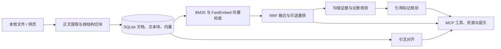

# DocCite

DocCite 是一个本地文档检索与引用核验 MCP 服务。客户端可以先检索证据并生成带引用的回答，再定位引文、核对数字和检查引用的文档或页码。默认检索和核验在本机运行，首次使用向量检索或重排会下载对应的 ONNX 模型。

## 快速开始

在项目根目录运行以下命令。项目使用 Python 3.13 和 uv。

```powershell
uv sync --locked
uv run doccite ingest examples/corpus
uv run doccite search "青岚试点的单位产水能耗降低多少"
uv run doccite search "Harbor Ferry operating costs" --mode bm25
```

支持 UTF-8 Markdown/TXT、含文本层的 PDF、DOCX、HTML 和 HTTP(S) 网页。目录入库默认递归。索引和模型缓存默认位于项目下的 `.doccite/`。重新入库时按内容哈希跳过未变文件，内容变更时更新相应文档的文本、块和向量缓存。

## 设计



检索结果包含标题、PDF 原始页码、标题层级和块 ID。`start` 与 `end` 是提取后全文中的 Python 字符索引，左闭右开。可通过 `doccite://documents/{doc_id}` 按偏移复核文本，通过 `doccite://chunks/{chunk_id}` 读取单块，或通过 `doccite://stats` 查看索引统计。

| 工具 | 行为 |
| --- | --- |
| `ingest_documents`、`ingest_url` | 导入文件、目录或网页，返回每个来源的入库状态 |
| `list_documents`、`remove_document` | 查看文档 ID、管理索引条目 |
| `search`、`read_chunk` | 检索证据，读取同文档的相邻块 |
| `verify_quote` | 返回逐字匹配、排版归一化匹配、近似匹配或未找到，并提供可用的原文位置和差异 |
| `verify_claim` | 返回证据句、裁决及数字、限定条件和关键词差异 |
| `verify_citations` | 检查 `[1]`、`[^1]`、`[doc_id:p12]`，为无引用论断提供候选证据 |

本地论断核验采用保守的句级规则。语义相似度用于给候选证据排序，完整支持还要求论断与证据句措辞一致，或是证据句中按词对齐的一段摘录，并且论断中的每个数字都能在证据中找到（证据可以多出日期等数字，`12 percent`、`百分之 12` 与 `12%` 视为相同）。否定按整词判断，“不同”“未来”“无人机”不算否定。改写过的论断通常只得到部分支持。设置 `use_llm_judge=true` 可在客户端支持 MCP sampling 时将论断和证据句交给客户端模型判断蕴含或矛盾。客户端缺少 sampling 或请求失败时返回本地核验结果。

| 环境变量 | 默认值 |
| --- | --- |
| `DOCCITE_DATA_DIR` | `.doccite` |
| `DOCCITE_CHUNK_SIZE` / `DOCCITE_CHUNK_OVERLAP` | 600 / 100 个字符 |
| `DOCCITE_ENABLE_DENSE` | `true`，设为 `false` 可直接使用 BM25 |
| `DOCCITE_EMBEDDING_MODEL` | `BAAI/bge-small-zh-v1.5` |
| `DOCCITE_RERANKER_MODEL` | `BAAI/bge-reranker-base` |
| `DOCCITE_CLAIM_RERANK` | `false`，设为 `true` 对候选证据句运行重排 |
| `DOCCITE_QUOTE_THRESHOLD` | 0.80 |
| `DOCCITE_CLAIM_PARTIAL_THRESHOLD` / `DOCCITE_CLAIM_SUPPORTED_THRESHOLD` | 0.50 / 0.90 |

## 接入 MCP 客户端

### Claude Code

在项目目录运行以下命令。按实际检出路径调整 `--directory`。[Claude Code MCP 配置文档](https://code.claude.com/docs/en/mcp#option-3-add-a-local-stdio-server)

```powershell
claude mcp add --transport stdio doccite -- uv --directory 'D:\code\projects\MCP-demo' run --locked doccite serve
claude mcp get doccite
```

### Claude Desktop

在 Claude Desktop 的开发者设置中打开 `claude_desktop_config.json`，将下例中的 `doccite` 条目加入 `mcpServers`，重启客户端。Windows 下可用 `(Get-Command uv).Source` 确定 `uv.exe` 路径。[本地 MCP 服务配置文档](https://modelcontextprotocol.io/docs/develop/connect-local-servers)

```json
{
  "mcpServers": {
    "doccite": {
      "command": "E:\\Develop\\Python\\Scripts\\uv.exe",
      "args": [
        "--directory", "D:\\code\\projects\\MCP-demo",
        "run", "--locked", "doccite", "serve"
      ]
    }
  }
}
```

### MCP Inspector 与本地 HTTP

用 Inspector 查看工具、资源和提示，或用 Streamable HTTP 连接本机服务。[MCP Inspector 文档](https://modelcontextprotocol.io/docs/tools/inspector)

```powershell
npx @modelcontextprotocol/inspector uv run --locked doccite serve
uv run --locked doccite serve --transport streamable-http --host 127.0.0.1 --port 8000
```

HTTP MCP 地址是 `http://127.0.0.1:8000/mcp`。服务默认监听回环地址，同机客户端可通过工具读取本地文件和抓取网页。

## 演示

> 导入 `examples/corpus`。使用 `answer_with_citations` 查找 Harbor Ferry 试点的运营成本变化，再用 `fact_check` 核验下面这句话。把 `[1]` 映射到入库返回的 ferry 文档 ID。
>
> The pilot reduced operating costs by 21% [1]. Another report confirmed the result [fabricated:p1].

原文的运营成本降幅为 12%。`verify_quote` 将改过数字的引文标为 `modified`，`verify_claim` 返回 `PARTIALLY_SUPPORTED` 并列出数字差异，`verify_citations` 将第二条来源标为 `missing_document`。编号引用通过 `sources` 参数指定，例如 `{"1": "<doc_id>"}` 或 `{"1": "<doc_id>:p3"}`。`[^1]` 与 `[1]` 共用编号映射。

## 评测与测试

```powershell
uv run --locked doccite eval
uv run --locked ruff check .
uv run --locked pytest
```

评测使用 8 份自编中英文文档、24 个文本块、12 条检索查询和 34 条按类别标注的论断。评测索引与日常使用的索引分开保存。默认模型的本机实测结果如下。

| 检索方式 | Recall@5 | MRR@5 |
| --- | ---: | ---: |
| BM25 | 0.833 | 0.736 |
| 向量 | 1.000 | 0.854 |
| 混合 | 1.000 | 0.917 |
| 混合 + 重排 | 1.000 | 0.958 |

论断标签的含义：`SUPPORTED` 为原文确实支持；`PARTIALLY_SUPPORTED` 为找到相关原文，但数字、否定、主体或限定条件与原文不一致；`NOT_FOUND` 为语料中没有相关证据。本地核验整体命中 **28/34（0.824）**，分类结果如下。

| 类别 | 说明 | 命中 |
| --- | --- | ---: |
| 原句 | 与原文句子一致 | 6/6 |
| 摘录 | 原句的一段，或 `12 percent`、`百分之 8.5` 等单位写法不同 | 5/5 |
| 改写 | 意思相同但换了措辞 | **0/6** |
| 篡改数字 | 改动百分比、时长、年份 | 5/5 |
| 否定反转 | 加入或去掉否定 | 3/3 |
| 主体替换 | 换人员、地点或日期 | 3/3 |
| 限定条件 | 去掉“up to”，加入“预计” | 2/2 |
| 无证据 | 语料中没有相关内容 | 4/4 |

**误判为支持：0/17**（17 条标签不是 `SUPPORTED` 的论断没有一条被判为支持）。`SUPPORTED` 召回 11/17，漏掉的 6 条都是改写，被判为 `PARTIALLY_SUPPORTED`。本地规则只在措辞与原文一致或为原文摘录时给出完整支持，宁可少判支持，也不把篡改过的论断判为支持。改写类论断可设置 `use_llm_judge=true`，借助客户端模型做蕴含判断；sampling 裁决由协议集成测试覆盖，未纳入此离线评测。

| 标签 \ 预测 | SUPPORTED | PARTIALLY_SUPPORTED | NOT_FOUND |
| --- | ---: | ---: | ---: |
| SUPPORTED | 11 | 6 | 0 |
| PARTIALLY_SUPPORTED | 0 | 13 | 0 |
| NOT_FOUND | 0 | 0 | 4 |
